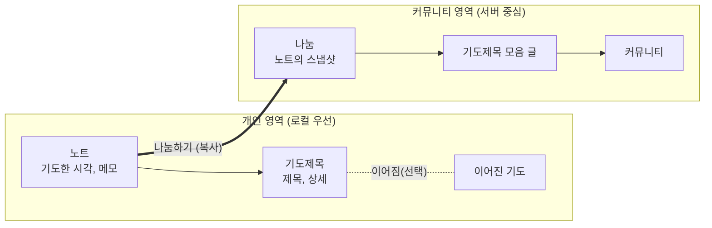

# 아키텍처: 쌓이는 기도 (시스템 전체)

> 현재 유효한 설계만, 결정한 순서가 아니라 의미 순서로 적는다. 이력은 쓰지 않는다(ADR과 git에 있다).
> 이 문서는 모든 스코프에 적용된다. 구현은 이 문서와 `REQUIREMENTS.md`, `CONVENTIONS.md`만 따른다.

## 현재 상태

- **스코프**: `/` (시스템 전체)
- **상위 스코프**: 없음
- **진행 중인 이행**: 없음
- **구현**: 뼈대와 `/health`만 있다. 설계 기준선이 앞서 있다

## 개요

처음 읽는 사람과 에이전트가 여기서 시작한다. 이 절과 이어지는 설계 절을 순서대로 읽으면 시스템을 파악할 수 있게 쓴다.

**조감도**: "쌓이는 기도"는 소그룹 리더가 회원들의 기도제목을 모아 공유하는 서비스다. 회원은 메모 앱처럼 기도 노트를 쓰고, 그중 나누고 싶은 노트를 커뮤니티에 **나눔**으로 올린다. 리더는 나눔들을 골라 **기도제목 모음** 글로 올린다.
개인 기록은 정리를 강제하지 않는다. 노트에 기도제목을 행 단위로 쓰고, 같은 기도는 "오늘도 기도"로 이어 가면 묶음이 저절로 생긴다. 개인 노트는 작성자만 보고, 다른 사람에게 보이는 것은 나눔(그 시점의 복사본)뿐이다.

**코드 지도**: pnpm workspace와 Turborepo로 묶은 모노리포다. 저장소 전체가 ESM과 TypeScript 6.0이다.

| 경로 | 역할 |
|---|---|
| `apps/web/` | 웹. TanStack Start(SPA 모드) + TanStack Query, Tailwind CSS. 서버는 `openapi-fetch`로 부르고, 개발 중에는 `/api`를 서버로 프록시한다 |
| `apps/server/` | 서버. NestJS 12 + Drizzle 0.45 + PostgreSQL. 테이블 정의는 `src/database/schema.ts` |
| `packages/api-contract/` | API 계약. `openapi.yaml`이 원본이고, 빌드할 때 TypeScript 타입을 생성한다 |
| `packages/domain/` | 웹과 서버가 함께 쓰는 도메인 규칙 |
| `architecture/` | 요구사항, 아키텍처, 컨벤션 문서와 결정 기록 |
| `compose.yaml` | 로컬 개발용 PostgreSQL |

## 스코프 목록

하위 스코프를 만들면 여기에 등록한다. `design-harness check`가 누락을 확인한다.

| 경로 | 다루는 것 |
|---|---|
| `/` | 시스템 전체 |

## 범위

- **다루는 것**: 개인 기도 노트, 노트의 나눔, 커뮤니티와 기도제목 모음, 계정과 동기화
- **다루지 않는 것 (지금은)**: 친구, DM, 익명 한줄 멘트, 긴급 기도 푸시, 출력(PDF 등), 교회 조직, 성경 콘텐츠, 광고. 보류한 요구로 notes에 있다

## 개인 기록 모델

노트와 기도제목만 기본 단위로 둔다. 주제 컨테이너는 없고, 이어진 기도는 쓰는 중에 저절로 생기며, 정리는 나중에 쉽게 한다. 기도제목의 경계는 사용자가 행 단위로 정하고, 서식에서 추론하지 않는다.

| 개념 | 정의 | 주요 속성 |
|---|---|---|
| **노트** | 한 번에 쓴 기도 기록. 하루에 여러 개 쓸 수 있다 | 기도한 시각, 메모(자유 글, 선택), 기도제목 목록(순서 있음), 태그(선택) |
| **기도제목** | 노트 안의 항목 하나. 의미상 기도제목 하나이고 이어짐, 나눔, 검색의 단위 | 제목(한 줄, 선택), 상세(자유 글, 선택). 둘 중 하나 이상. 태그(선택), 이어진 기도(선택) |
| **이어진 기도** | 같은 기도를 이어 온 기도제목들의 묶음. 여러 노트에 걸친다. 이름과 자체 태그가 없고 사용자가 직접 만들지 않는다 | 속한 기도제목들. "오늘도 기도"나 연결을 할 때 생기고 합칠 수 있다 |
| **태그** | 사용자마다 따로 있는 분류 이름. 노트에는 쓴 맥락(새벽기도 등), 기도제목에는 기도의 주제(건강 등)로 붙인다 | 이름(사용자 안에서 겹치지 않는다) |
| **스마트 묶음** | 조건으로 기도제목을 모아 보는 저장된 보기. 데이터를 옮기지 않는다 | 조건(제목 포함, 태그, 기간 등) |

- 날짜별 보기는 노트를 기도한 시각의 날짜로 모아 보여 주는 화면이다. "하루"라는 엔티티는 없다
- 메모는 기도제목이 아닌 글(묵상, 그날의 마음, 서두)이다. 이어짐과 나눔 선택의 단위가 아니다
- 기도제목의 상세 안에서는 bullet 같은 서식을 자유롭게 쓴다. 서식이 새 기도제목을 만들지 않는다
- 이어진 기도는 한 기도의 타임라인으로 조회한다. 처음에는 기도제목이 공유하는 식별자로만 표현하고, 묶음 자체의 속성(응답 표시 등)이 필요해지면 별도 기록을 둔다

**태그의 상속**: 저장하는 태그는 노트와 기도제목에 직접 붙인 것뿐이다. 검색과 모아 보기에서는 상속을 계산한다. 노트의 태그를 떼면 그 안의 기도제목에서도 사라지고, 상속된 태그만 기도제목에서 떼어 낼 수는 없다.

| 대상 | 검색과 모아 보기에서의 태그 |
|---|---|
| 노트 | 노트에 직접 붙인 태그 |
| 기도제목 | 자기 태그 + 노트의 태그 + 이어진 기도의 태그 |
| 이어진 기도 | 속한 기도제목들의 자기 태그를 합친 것 (노트의 태그는 빼서, 쓴 맥락이 묶음의 주제로 번지지 않게 한다) |

그래서 "오늘도 기도"로 이어 쓴 기도제목은 태그를 다시 붙이지 않아도 같은 묶음의 태그로 찾힌다.

**감당하는 요구**: [노트 쓰기](REQUIREMENTS.md#노트-쓰기), [이어진 기도와 정리](REQUIREMENTS.md#이어진-기도와-정리), [모아 보기와 검색](REQUIREMENTS.md#모아-보기와-검색)

**가정과 한계**
- 전제한 것: 사용자는 쓰는 순간에 정리하지 않는다. 이어지는 기도는 대부분 "오늘도 기도"로 이어진다. 행 단위 입력이 bullet 목록 쓰기만큼 빠르다
- 감당하지 못하는 것: 기도제목을 주제별로 엄격히 관리하는 사용 방식, 자유 문서에서 기도제목을 자동으로 추출하는 방식, 이어진 기도 안의 기도제목 하나에만 붙는 태그, 상속된 태그를 기도제목에서만 떼어 내는 것
- 다시 볼 계기: 이어지지 않은 기록이 많아 돌아보기 어렵다는 피드백, 주제 단위 관리 요구, 입력이 번거롭다는 피드백, 나누기·합치기가 자주 쓰일 때, 상속된 태그 때문에 검색 결과가 흐려진다는 피드백

**이유**: [ADR-0001](decisions/0001-baseline-v1-design.md), [ADR-0004](decisions/0004-태그와-이어진-기도의-모델.md)

## 나눔

나눔은 노트를 나눌 때 만드는 복사본(스냅샷)이고, 서버에 있는 별도 엔티티다. 공개 범위는 나눔에 붙고, 원본에는 연결만 하며, 나눔의 주인은 작성자다.

| 개념 | 정의 | 주요 속성 |
|---|---|---|
| **나눔** | 노트를 나눌 때 만드는 복사본 | 작성자, 공개 대상, 복사된 기도제목 목록, 복사된 메모(선택), 원본 노트·기도제목 ID |

- 나눔을 만들 때 기본은 노트의 모든 기도제목이다. 일부를 빼거나 문장을 다듬을 수 있다. 메모는 기본으로 빼고, 원하면 넣는다
- 태그는 나눔에 복사하지 않는다. 태그는 개인적인 정리 수단이다
- 상태: 노트에서 나눔하기로 **게시됨**이 되고, 작성자가 고쳐도 게시됨이다. 작성자가 지우면 **삭제됨**(표시)이 된다. 모음 글은 나눔을 참조하므로, 삭제된 나눔은 모음에서 "삭제된 나눔"으로 보인다

**감당하는 요구**: [나눔 만들기](REQUIREMENTS.md#나눔-만들기), [공개 대상](REQUIREMENTS.md#공개-대상)

**가정과 한계**
- 전제한 것: 소그룹에서는 그 시점의 버전을 나눈다
- 감당하지 못하는 것: 원본이 바뀌면 자동으로 따라가는 공유
- 다시 볼 계기: 원본을 따라가는 공유(개인 기도방의 "항상 최신" 등) 요구

**이유**: [ADR-0001](decisions/0001-baseline-v1-design.md), [ADR-0004](decisions/0004-태그와-이어진-기도의-모델.md)

## 커뮤니티

| 개념 | 정의 | 주요 속성 |
|---|---|---|
| **커뮤니티** | 회원들이 모인 단위(소그룹 등) | 이름, 멤버십 |
| **멤버십** | 회원과 커뮤니티의 관계 | 역할: 소유자, 관리자, 멤버 |
| **공지사항** | 커뮤니티 글. 상단에 고정할 수 있다 | 작성자(소유자·관리자), 본문, 고정 여부 |
| **기도제목 모음** | 리더가 나눔들을 골라 올린 커뮤니티 글 | 작성자(소유자·관리자), 소개글, 참조하는 나눔 목록 |

- 커뮤니티 글은 타임라인으로 나열하고, 소유자와 관리자만 쓴다
- 리더는 모음을 만들 때 **나눔 단위로** 고른다

**감당하는 요구**: [커뮤니티와 역할](REQUIREMENTS.md#커뮤니티와-역할), [커뮤니티 글](REQUIREMENTS.md#커뮤니티-글), [기도제목 모음](REQUIREMENTS.md#기도제목-모음)

**가정과 한계**
- 전제한 것: 커뮤니티 기능은 온라인에서 쓴다
- 감당하지 못하는 것: 오프라인에서 커뮤니티 글 쓰기와 모음 만들기
- 다시 볼 계기: 오프라인 커뮤니티 사용 요구

**이유**: [ADR-0001](decisions/0001-baseline-v1-design.md)

## 영역과 모듈의 경계

개인 영역은 로컬 우선, 커뮤니티 영역은 서버 중심이다. **두 영역은 나눔으로만 연결된다.** 서버의 커뮤니티 모듈은 개인 기록(동기화된 노트 포함)을 읽지 않는다.

| 모듈 | 책임 | 실행 위치 |
|---|---|---|
| 개인 기록 | 노트, 기도제목, 이어진 기도, 스마트 묶음, 검색 | 클라이언트(웹, 앱) + 동기화 시 서버 |
| 동기화 | 기기와 서버 사이의 개인 데이터 복제 | 클라이언트 + 서버 |
| 나눔 | 노트에서 스냅샷을 만들어 올리기, 나눔 수정·삭제 | 클라이언트에서 복사, 서버에 저장 |
| 커뮤니티 | 커뮤니티, 멤버십, 공지사항, 기도제목 모음 | 서버 (온라인 필요) |
| 계정 | 이메일 가입, 소셜 로그인 | 서버 |

**클라이언트와 서버**: 비즈니스 규칙의 기준은 서버에 있고, 데이터의 원본은 [데이터 원본과 동기화](#데이터-원본과-동기화)를 따른다. 클라이언트(웹, 앱)는 서버와 API로만 주고받고, 입력 검증과 표시에는 서버와 같은 도메인 규칙(`packages/domain`)을 쓴다. 오프라인에서는 클라이언트가 직접 검증해야 하기 때문이다. 클라이언트는 공유 규칙 밖의 비즈니스 규칙을 새로 정의하지 않는다.

**감당하는 요구**: [기록의 비공개](REQUIREMENTS.md#기록의-비공개), [계정](REQUIREMENTS.md#계정)

**가정과 한계**
- 전제한 것: 다른 사람에게 보여 줄 것은 나눔(복사본)으로 충분하다. 커뮤니티 기능은 온라인에서 쓴다. 클라이언트에 필요한 규칙은 공유 도메인 규칙으로 충분하다
- 감당하지 못하는 것: 개인 기록을 다른 사람과 직접 공유하거나 함께 편집하는 것, 클라이언트가 서버를 거치지 않고 서버 DB에 접근하거나 서버와 다른 규칙을 갖는 구조
- 다시 볼 계기: 개인 기록 자체를 공유하자는 요구, 커뮤니티 모듈이 개인 기록을 읽어야 하는 기능이 생길 때, 클라이언트에만 필요한 규칙이 생길 때

**이유**: [ADR-0001](decisions/0001-baseline-v1-design.md)

## 데이터 원본과 동기화

앱 가입 전에는 기기 DB가, 동기화를 켜면 서버가 원본이다. 웹은 로그인과 동기화가 필수다.

| 모드 | 어디서 | 원본 | 기기 DB |
|---|---|---|---|
| 로컬 전용 | 앱 (가입 전) | 기기 DB | 유일한 원본 |
| 동기화 | 앱 (가입 후 동기화 켬) | 서버 | 오프라인에서도 쓰는 복제본 |
| 웹 | 웹 (로그인 필수) | 서버 | 캐시. 사라져도 서버에 있다 |

- 로컬 전용에서 가입하고 동기화를 켜면 기존 기록을 서버로 옮긴다
- 클라이언트 생성 ID, 레코드별 버전과 수정 시각, 삭제 표시(tombstone), 서버의 변경 순서를 웹 단계부터 갖춘다. 충돌은 필드 단위로 마지막 수정이 이긴다

**감당하는 요구**: [웹 사용](REQUIREMENTS.md#웹-사용), [앱 사용과 오프라인](REQUIREMENTS.md#앱-사용과-오프라인)

**가정과 한계**
- 전제한 것: 개인 노트를 여러 기기에서 동시에 고치는 일은 드물다. 필드 단위로 "마지막 수정이 이긴다"면 충분하다
- 감당하지 못하는 것: 여러 사람이 같은 노트를 함께 편집하는 기능, 같은 글을 문자 단위로 동시에 편집해 병합하는 것, 동기화를 끄거나 로그아웃할 때의 데이터 처리(아직 정하지 않음)
- 다시 볼 계기: 공동 편집 요구, 동기화 충돌이 잦을 때, 충돌로 기록을 잃었다는 사례

**이유**: [ADR-0001](decisions/0001-baseline-v1-design.md)

## 기술 스택과 실행 환경

- **언어와 저장소**: TypeScript 모노리포(pnpm workspace + Turborepo)
- **웹**: React 기반의 TanStack Start + TanStack Query, Tailwind CSS, Base UI(shadcn). SPA 모드로 시작하고 공유 페이지에만 라우트별 SSR을 켠다
- **서버**: NestJS. DB는 PostgreSQL, ORM은 Drizzle이고, 동기화 쿼리는 Drizzle의 SQL 수준 API로 쓴다
- **앱**: 기기 DB는 SQLite. 앱 프레임워크는 앱 개발을 시작할 때 정한다
- **실행 환경**: 로컬 개발은 Docker Compose로 PostgreSQL을 띄운다. 운영 DB는 관리형 PostgreSQL을 쓰는 방향이다

**감당하는 요구**: [플랫폼](REQUIREMENTS.md#플랫폼)

**가정과 한계**
- 전제한 것: 혼자 개발하고 웹을 먼저 만든다. TypeScript ORM은 서버에서만 쓴다(앱은 네이티브 예정). 로그인 뒤 화면은 SSR이 필요 없고, 링크 미리보기가 필요한 페이지는 소수다. 개발 기기에 Docker가 있다
- 감당하지 못하는 것: 앱과 서버가 같은 ORM 스키마를 공유하는 구조, 운영 DB를 직접 컨테이너로 운영하는 것
- 다시 볼 계기: 앱 개발을 시작할 때(앱 프레임워크 결정), 앱을 TypeScript 기반으로 만들기로 할 때, 동기화 쿼리를 Drizzle로 표현하기 어려울 때, SSR이 필요한 화면이 많아질 때, Start의 잦은 변경이 개발을 자주 막을 때, 배포 대상을 정할 때

**이유**: [ADR-0001](decisions/0001-baseline-v1-design.md), [ADR-0002](decisions/0002-postgresql-and-drizzle.md), [ADR-0003](decisions/0003-web-framework-api-contract-runtime.md)

## API 계약

API 계약은 `packages/api-contract`의 OpenAPI 명세가 원본이다(명세 우선). 개인 영역은 일반 API로 시작하고 동기화의 기반 장치(클라이언트 생성 ID, 버전, 삭제 표시)를 지키며, 동기화 API는 나중에 같은 명세에 더한다.

**감당하는 요구**: [웹 사용](REQUIREMENTS.md#웹-사용), [플랫폼](REQUIREMENTS.md#플랫폼)

**가정과 한계**
- 전제한 것: 모든 클라이언트(웹, 네이티브 앱)가 HTTP API로만 서버와 통신한다
- 감당하지 못하는 것: 명세 없이 구현에서 계약이 정해지는 것
- 다시 볼 계기: 명세와 구현이 자주 어긋날 때, 명세 작성이 개발 속도를 크게 늦출 때

**이유**: [ADR-0003](decisions/0003-web-framework-api-contract-runtime.md)

## 불변식

항상 참이어야 하는 규칙. 구현이 이를 어겨야 한다면 멈춤 규칙에 해당한다.

- 기도제목은 정확히 하나의 노트에 속한다
- 기도제목은 제목과 상세 중 하나 이상을 가진다
- 기도제목은 이어진 기도에 최대 하나 속한다
- 저장되는 태그는 노트와 기도제목에 직접 붙인 것뿐이다. 상속된 태그는 계산 결과다
- 개인 영역의 데이터(노트, 메모, 기도제목, 이어진 기도)는 작성자만 읽을 수 있다. 다른 사람에게 보이는 것은 나눔뿐이다
- 나눔은 만든 뒤 원본 노트와 기도제목의 변경에 영향을 받지 않는다
- 나눔을 고치거나 지울 수 있는 것은 작성자뿐이다. 리더는 모음에 넣거나 뺄 수만 있다
- 모든 레코드의 ID는 클라이언트에서 만들고 바뀌지 않는다
- 개인 데이터의 삭제는 삭제 표시(tombstone)로 한다
- 클라이언트(웹, 앱)는 서버와 HTTP API로만 통신하고, 그 API는 OpenAPI 명세에 있다. 클라이언트는 서버 DB에 직접 접근하지 않는다

## 이행 중인 레거시

아직 코드에 남아 있지만 현재 설계가 아닌 것이다. **모방하지 않는다.** 정리가 끝나면 행을 지운다.

| 대상 (경로) | 대신 따를 설계 | 정리 방법 |
|---|---|---|
