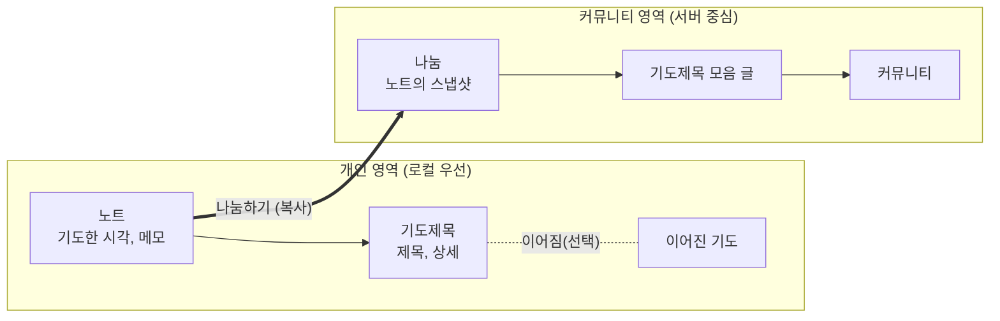

# 아키텍처: 쌓이는 기도 (시스템 전체)

> 현재 유효한 설계만 적는다. 이력은 쓰지 않는다(ADR과 git에 있다).
> 이 문서는 모든 스코프에 적용된다. 하위 스코프는 이 문서의 규칙을 뒤집을 수 없다.

## 현재 상태

- **스코프**: `/` (시스템 전체)
- **상위 스코프**: 없음
- **결정 대기**: 없음
- **진행 중인 이행**: 없음
- **구현**: 아직 코드가 없다. 설계 기준선만 있다

## 개요

처음 읽는 사람과 에이전트가 여기서 시작한다. 이 절, 불변식, 현재 유효한 결정 순서로 읽으면 시스템을 파악할 수 있게 쓴다. 이력은 쓰지 않는다.

**조감도**: "쌓이는 기도"는 소그룹 리더가 회원들의 기도제목을 모아 공유하는 서비스다. 회원은 메모 앱처럼 기도 노트를 쓰고, 그중 나누고 싶은 노트를 커뮤니티에 **나눔**으로 올린다. 리더는 나눔들을 골라 **기도제목 모음** 글로 올린다.
개인 기록은 정리를 강제하지 않는다. 노트에 기도제목을 행 단위로 쓰고, 같은 기도는 "오늘도 기도"로 이어 가면 묶음이 저절로 생긴다. 개인 노트는 작성자만 보고, 다른 사람에게 보이는 것은 나눔(그 시점의 복사본)뿐이다.



**코드 지도**: 아직 코드가 없다. 구조가 정해지면 여기에 적는다.

| 경로 | 역할 |
|---|---|

## 스코프 목록

하위 스코프를 만들면 여기에 등록한다. 검사 스크립트가 누락을 확인한다.

| 경로 | 다루는 것 |
|---|---|
| `/` | 시스템 전체 |

## 범위

- **다루는 것**: 개인 기도 노트, 노트의 나눔, 커뮤니티와 기도제목 모음, 계정과 동기화
- **다루지 않는 것 (지금은)**: 친구, DM, 익명 한줄 멘트, 긴급 기도 푸시, 출력(PDF 등), 교회 조직, 성경 콘텐츠, 광고. 요구사항에는 보류로 남아 있다

## 도메인 모델

### 개인 영역

| 개념 | 정의 | 주요 속성 |
|---|---|---|
| **노트** | 한 번에 쓴 기도 기록. 하루에 여러 개 쓸 수 있다 | 기도한 시각, 메모(자유 글, 선택), 기도제목 목록(순서 있음) |
| **기도제목** | 의미상 기도제목 하나. 이어짐, 나눔, 검색의 단위 | 제목(한 줄, 선택), 상세(자유 글, 선택). 둘 중 하나 이상 |
| **이어진 기도** | 같은 기도를 이어 온 기도제목들의 묶음. 사용자가 직접 만들지 않는다 | 속한 기도제목들. "오늘도 기도"나 연결을 할 때 생기고 합칠 수 있다 |
| **스마트 묶음** | 조건으로 기도제목을 모아 보는 저장된 보기. 데이터를 옮기지 않는다 | 조건(제목 포함, 태그, 기간 등) |

- 날짜별 보기는 노트를 기도한 시각의 날짜로 모아 보여 주는 화면이다. "하루"라는 엔티티는 없다
- 메모는 기도제목이 아닌 글(묵상, 그날의 마음, 서두)이다. 이어짐과 나눔 선택의 단위가 아니다
- 기도제목의 상세 안에서는 bullet 같은 서식을 자유롭게 쓴다. 서식이 새 기도제목을 만들지 않는다

### 커뮤니티 영역

| 개념 | 정의 | 주요 속성 |
|---|---|---|
| **나눔** | 노트를 나눌 때 만드는 복사본. 서버에 있는 별도 엔티티 | 작성자, 공개 대상, 복사된 기도제목 목록, 복사된 메모(선택), 원본 노트·기도제목 ID |
| **커뮤니티** | 회원들이 모인 단위(소그룹 등) | 이름, 멤버십 |
| **멤버십** | 회원과 커뮤니티의 관계 | 역할: 소유자, 관리자, 멤버 |
| **공지사항** | 커뮤니티 글. 상단에 고정할 수 있다 | 작성자(소유자·관리자), 본문, 고정 여부 |
| **기도제목 모음** | 리더가 나눔들을 골라 올린 커뮤니티 글 | 작성자(소유자·관리자), 소개글, 참조하는 나눔 목록 |

- 나눔을 만들 때 기본은 노트의 모든 기도제목이다. 일부를 빼거나 문장을 다듬을 수 있다. 메모는 기본으로 빼고, 원하면 넣는다
- 리더는 모음을 만들 때 **나눔 단위로** 고른다

## 상태와 상태 전이

**나눔**

```
(노트에서 나눔하기) ──▶ 게시됨 ──(작성자가 수정)──▶ 게시됨
                         └──(작성자가 삭제)──▶ 삭제됨(표시)
```

모음 글은 나눔을 참조하므로, 삭제된 나눔은 모음에서 "삭제된 나눔"으로 보인다.

**개인 데이터의 원본 모드**

| 모드 | 어디서 | 원본 | 기기 DB |
|---|---|---|---|
| 로컬 전용 | 앱 (가입 전) | 기기 DB | 유일한 원본 |
| 동기화 | 앱 (가입 후 동기화 켬) | 서버 | 오프라인에서도 쓰는 복제본 |
| 웹 | 웹 (로그인 필수) | 서버 | 캐시. 사라져도 서버에 있다 |

로컬 전용에서 가입하고 동기화를 켜면 기존 기록을 서버로 옮긴다. 동기화를 끄거나 로그아웃할 때의 처리는 아직 정하지 않았다(R-017).

## 모듈과 경계

| 모듈 | 책임 | 실행 위치 |
|---|---|---|
| 개인 기록 | 노트, 기도제목, 이어진 기도, 스마트 묶음, 검색 | 클라이언트(웹, 앱) + 동기화 시 서버 |
| 동기화 | 기기와 서버 사이의 개인 데이터 복제 | 클라이언트 + 서버 |
| 나눔 | 노트에서 스냅샷을 만들어 올리기, 나눔 수정·삭제 | 클라이언트에서 복사, 서버에 저장 |
| 커뮤니티 | 커뮤니티, 멤버십, 공지사항, 기도제목 모음 | 서버 (온라인 필요) |
| 계정 | 이메일 가입, 소셜 로그인 | 서버 |

- **개인 영역과 커뮤니티 영역은 나눔으로만 연결된다.** 서버의 커뮤니티 모듈은 개인 기록(동기화된 노트 포함)을 읽지 않는다
- 도메인 규칙은 클라이언트와 서버가 함께 쓴다. 오프라인에서는 클라이언트가 직접 검증해야 하기 때문이다

## 불변식

항상 참이어야 하는 규칙. 구현이 이를 어겨야 한다면 멈춤 규칙에 해당한다.

- 기도제목은 정확히 하나의 노트에 속한다
- 기도제목은 제목과 상세 중 하나 이상을 가진다
- 기도제목은 이어진 기도에 최대 하나 속한다
- 개인 영역의 데이터(노트, 메모, 기도제목, 이어진 기도)는 작성자만 읽을 수 있다. 다른 사람에게 보이는 것은 나눔뿐이다
- 나눔은 만든 뒤 원본 노트와 기도제목의 변경에 영향을 받지 않는다
- 나눔을 고치거나 지울 수 있는 것은 작성자뿐이다. 리더는 모음에 넣거나 뺄 수만 있다
- 모든 레코드의 ID는 클라이언트에서 만들고 바뀌지 않는다
- 개인 데이터의 삭제는 삭제 표시(tombstone)로 한다

## 현재 유효한 결정

새 요구사항은 이 표의 "전제한 가정"과 "수용하지 못하는 것"에 비추어 영향 분석을 한다.

| ID | 결정 | 전제한 가정 | 수용하지 못하는 것 | 재검토 트리거 | 근거 |
|---|---|---|---|---|---|
| D-01 | 노트와 기도제목만 기본 단위로 둔다. 주제 컨테이너는 없고, 이어진 기도는 쓰는 중에 저절로 생기며, 정리는 나중에 쉽게 한다 | 사용자는 쓰는 순간에 정리하지 않는다. 이어지는 기도는 대부분 "오늘도 기도"로 이어진다 | 기도제목을 주제별로 엄격히 관리하는 사용 방식 | 이어지지 않은 기록이 많아 돌아보기 어렵다는 피드백, 주제 단위 관리 요구 | [ADR-0001](decisions/0001-baseline-v1-design.md) |
| D-02 | 기도제목의 경계는 사용자가 행 단위로 정한다. 서식에서 추론하지 않는다 | 행 단위 입력이 bullet 목록 쓰기만큼 빠르다 | 자유 문서에서 기도제목을 자동으로 추출하는 방식 | 입력이 번거롭다는 피드백, 나누기·합치기가 자주 쓰일 때 | [ADR-0001](decisions/0001-baseline-v1-design.md) |
| D-03 | 나눔은 노트의 스냅샷인 별도 엔티티다. 공개 범위는 나눔에 붙고, 원본에는 연결만 하며, 나눔의 주인은 작성자다 | 소그룹에서는 그 시점의 버전을 나눈다 | 원본이 바뀌면 자동으로 따라가는 공유 | 원본을 따라가는 공유(개인 기도방의 "항상 최신" 등) 요구 | [ADR-0001](decisions/0001-baseline-v1-design.md) |
| D-04 | 개인 영역은 로컬 우선, 커뮤니티 영역은 서버 중심이다. 두 영역은 나눔으로만 연결된다 | 커뮤니티 기능은 온라인에서 쓴다 | 오프라인에서 커뮤니티 글 쓰기와 모음 만들기 | 오프라인 커뮤니티 사용 요구 | [ADR-0001](decisions/0001-baseline-v1-design.md) |
| D-05 | 앱 가입 전에는 기기 DB가, 동기화를 켜면 서버가 원본이다. 웹은 로그인과 동기화가 필수다 | 개인 노트를 여러 기기에서 동시에 고치는 일은 드물다 | 여러 사람이 같은 노트를 함께 편집하는 기능 | 공동 편집 요구, 동기화 충돌이 잦을 때 | [ADR-0001](decisions/0001-baseline-v1-design.md) |
| D-06 | 클라이언트 생성 ID, 레코드별 버전과 수정 시각, 삭제 표시, 서버의 변경 순서를 웹 단계부터 갖춘다 | 필드 단위로 "마지막 수정이 이긴다"면 충분하다 | 같은 글을 문자 단위로 동시에 편집해 병합하는 것 | 충돌로 기록을 잃었다는 사례 | [ADR-0001](decisions/0001-baseline-v1-design.md) |
| D-07 | TypeScript 모노리포. 웹은 React, Tailwind CSS, Base UI(shadcn), 서버는 NestJS, 앱의 기기 DB는 SQLite | 혼자 개발하고 웹을 먼저 만든다 | — | 앱 개발을 시작할 때(앱 프레임워크 결정) | [ADR-0001](decisions/0001-baseline-v1-design.md) |

## 아직 정하지 않은 것

결정이 아니다. 구현이나 논의가 그 지점에 닿으면 정한다.

- 서버 DB (PostgreSQL이 유력), ORM, 동기화 구현 방식(직접 구현 또는 동기화 엔진)
- 도메인 규칙 공유 패키지와 모노리포 폴더 구조
- 앱 프레임워크 (React Native/Expo 또는 Capacitor)
- 응답 표시를 어디에 둘지 (기도제목, 이어진 기도, 별도 기록)
- 노트 제목을 둘지, 기도한 시각을 사용자가 바꿀 수 있는지
- 동기화를 끄거나 로그아웃할 때 서버와 기기의 데이터 처리
- 커뮤니티 가입 방식 (초대 링크 등)

## 이행 중인 레거시

아직 코드에 남아 있지만 현재 설계가 아닌 것이다. **모방하지 않는다.** 정리가 끝나면 행을 지운다.

| 대상 (경로) | 대체한 결정 | 정리 방법 |
|---|---|---|
